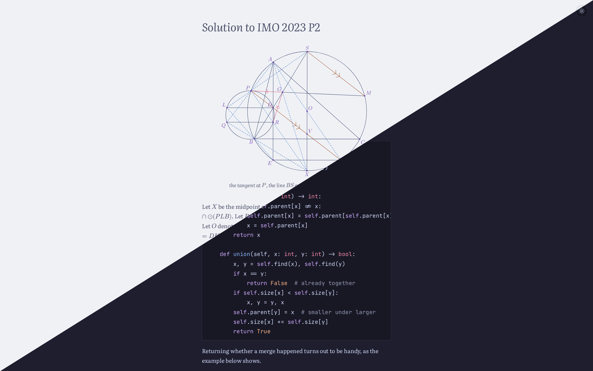
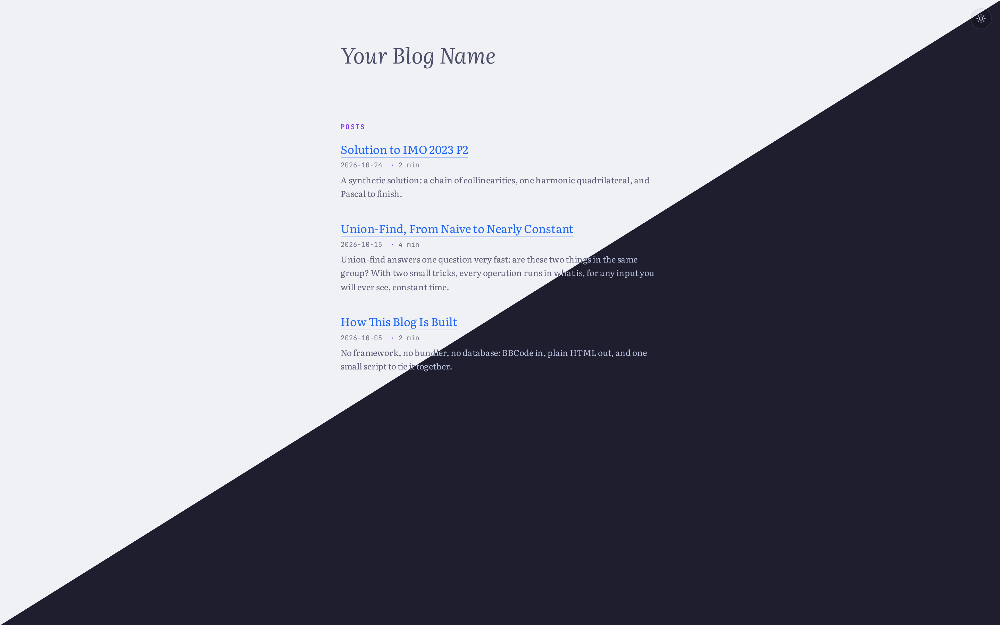

# Blog

A static blog template. Posts are written in BBCode and turned into HTML by
[bloops](https://github.com/Bubu-Droid/bloops); the site itself is plain HTML,
CSS and a little JavaScript, with no framework and nothing running on the
server.



*The posts shown are examples, not part of the template.*

## Features

- Light and dark themes that follow the reader's system, with a toggle.
- Maths through MathJax, highlighted code, Asymptote diagrams compiled to SVG,
  theorem boxes and sidenotes.
- A home page post list with dates, reading times and excerpts, generated from
  `posts.json`.
- A pre-push hook that keeps the post list and page titles up to date.
- Deploys to Vercel as-is: no build step.

## The home page



*Every post gets its title, date, reading time and excerpt, newest first.*

## Quick start

1. Create a repository from this template and clone it.
2. Install the tools and the pre-push hook:

   ```bash
   uv tool install bloops
   uv tool install prek   # or: pip install bloops prek
   prek install
   ```

3. Write a post: make a folder such as `my-post/`, copy the `static/` stubs from
   an existing post into it, and write `my-post/content.bbcode`, starting with
   the title as `[h1]My Post[/h1]`. Then build it:

   ```bash
   bloops -pc -i my-post   # live preview while writing
   bloops -i my-post       # build once
   ```

4. Add the post to `posts.json` and update the home page:

   ```json
   { "slug": "my-post", "date": "2026-10-28", "excerpt": "What the post is about." }
   ```

   ```bash
   uv run build.py   # or: python3 build.py, with Python 3.12+
   ```

5. Preview the whole site by running `python3 -m http.server` from the blog's
   root folder (or `python3 -m http.server -d path/to/blog` from anywhere else)
   and opening <http://localhost:8000>. Then commit and push; Vercel deploys
   every push.

## Documentation

The [Getting Started](getting-started/content.bbcode) post covers all of this in
detail: the folder layout, every command, what `build.py` checks, and
publishing. Read it rendered at <http://localhost:8000/getting-started/> after
starting the local server.
